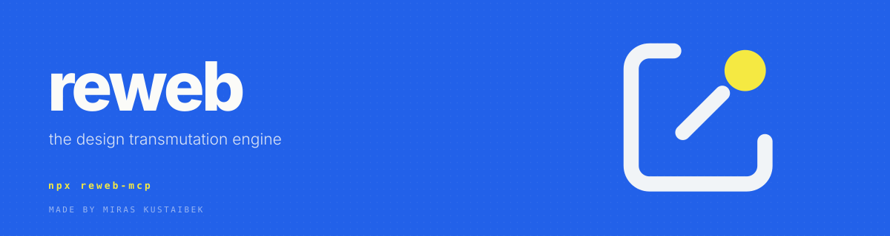

<div align="center">



[](https://www.npmjs.com/package/reweb-mcp)
[](https://www.npmjs.com/package/reweb-mcp)
[](LICENSE)

**Clone any website's design system into your stack. Computed, not vibes.**


</div>

## The loop

```bash
npx reweb-mcp@latest linear.app
```

That's it. ReWeb opens the site in a headless browser, dismisses the cookie
walls, waits for the fonts, and reads **computed styles straight off the DOM** —
negative tracking, inner bevels, border alphas, radii. Then it presses them
into your project:

```
.reweb/linear.app/
├── dna.json              ← the full design matrix
├── globals.css           ← tokens for Tailwind v4
├── tailwind.config.ts
├── full-desktop.png      ← 1440 @2x
├── full-mobile.png       ← 390 @3x
└── section-1-hero.png    ← every section, isolated
```

Then you build, and ReWeb verifies it 1-to-1:

```bash
npx reweb-mcp@latest diff .reweb/linear.app/section-1-hero.png ./app/hero.png
```

Mismatch over 3%? It shows you exactly where, in hot magenta.

## Inside your agent

MCP server + CLI in one package. One command registers it everywhere:

```bash
npm i -g reweb-mcp && reweb setup all
```

<details>
<summary>… or wire it by hand</summary>

```json
{
  "mcpServers": {
    "reweb": {
      "command": "npx",
      "args": ["-y", "reweb-mcp@latest", "mcp"]
    }
  }
}
```

Works in OpenCode, Claude Code, Cursor, Windsurf and Cline —
drop the snippet into that client's `mcp.json`.

</details>

## Tools

| | tool | what it does |
|---|---|---|
| ◉ | `reweb_extract_dna` | capture any live URL → computed DNA + retina section shots |
| ◉ | `reweb_compile_tokens` | press the DNA into `globals.css`, `tailwind.config.ts`, font links |
| ◉ | `reweb_visual_diff` | pixel-level match against the reference, 3% gate |

First run needs a browser? `reweb doctor` checks everything and tells you the
one command to fix it.

<div align="center">

---

**MIT** · made by **Miras Kustaibek** · built with reweb, obviously

</div>
